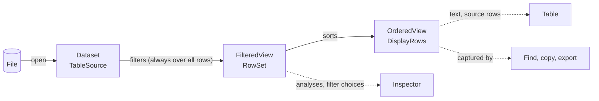
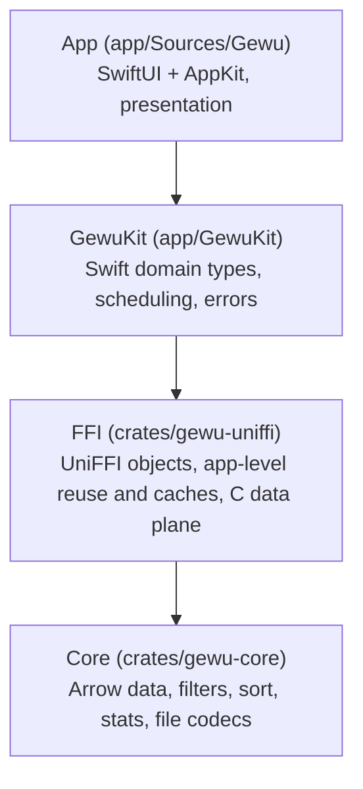

# Architecture

This is the one-page model of how Gewu is built: which objects stand between a file and a table cell, what each layer owns, and what each layer must not contain. It is the starting point for reading or reviewing the code. Details live closer to the code: [Core](../crates/gewu-core/README.md), the [FFI contract](../crates/gewu-uniffi/README.md) and the [App and GewuKit](../app/README.md). Why things are this way is recorded in the [decision records](decisions/README.md); what a change must not break is in the [review checklist](review-checklist.md).

## Mental model

Gewu is a read-only viewer. Opening a file decodes it into memory once. After that, nothing moves or copies the data: a filter produces a set of source row numbers, a sort produces an order over those numbers, and the table formats only the cells it is about to show.

Three immutable objects describe what is on screen. Each answers one question and is replaced only when its own inputs change:

| Object | Answers | Replaced when | Keeps |
| --- | --- | --- | --- |
| Dataset | What does the file contain? | the file, worksheet or header option changes | decoded columns, schema, file metadata, per-column caches |
| FilteredView | Which rows pass the filters? | the filters change | the selected source rows; every analysis and filter-editor result |
| OrderedView | In what order are they shown? | the filters or the sort change | the display order; text, Find, copy and export read from it |

The same three objects appear in every layer under a layer-specific name:

| Layer | Dataset | FilteredView | OrderedView |
| --- | --- | --- | --- |
| Core (`gewu-core`) | `Dataset` | `FilteredView` | `OrderedView` |
| FFI (`gewu-uniffi`) | `GewuDataset` | `GewuFilteredView` | `GewuOrderedView` |
| GewuKit | `TableSource` | `RowSet` | `DisplayRows` |

So when you meet one of these types, you know how long it lives and what invalidates it. A pure sort change keeps the `RowSet` and all of its analyses; changing column visibility or order keeps both views and the text already read. Find (`CellFind`) and export (`ExportJob`) capture one `DisplayRows` and stay valid whatever later queries do.

## Layers

Dependencies point one way: App → GewuKit → FFI → Core. Each layer sees only the one below it.

### Core: general data semantics

Owns decoded Arrow data and everything that is true of data regardless of who displays it: typed filters and Find, sorting, statistics and histograms, file decoding and export. Views are immutable values; Core keeps no notion of a current view.

Must not contain:

- Frontend concepts: windows, visible columns, selection, panels, display wording, or which result is current.
- Any dependency on UniFFI or another binding generator. Boundary shapes are declared in the FFI crate (see [ADR 0006](decisions/0006-core-free-of-uniffi.md)).
- Cancellation checkpoints in in-memory scans ([ADR 0009](decisions/0009-no-in-memory-cancellation.md)). Export is the one cancellable operation.

### FFI: the boundary, plus app semantics that read better in Rust

Projects Core to Swift through UniFFI objects and records, and carries the application-level rules that are clearer next to the data: `apply(filters, sorts)` reuses whatever did not change, each filtered view caches its analyses, and Find steps and wraps internally. Bulk data crosses through the [data plane](#the-data-plane). Core errors become structured `GewuError` kinds.

Must not contain:

- Query algorithms or codecs. Those stay in Core.
- Interaction state: drafts, edit rules, what the user selected or is looking at.
- Scheduling. All exported functions are synchronous; Swift decides where and when they run.

### GewuKit: the Swift domain layer

The only Swift module that imports the generated bindings (`GewuBindings`, `gewuFFI`). It exposes the three result types, `TableSession`, Find and export jobs, Swift value types for queries and results, `GewuKitError`, and the value types that hold the rules of what the user edits (`TableState`, `FilterDraft`). It runs every Rust call on a serial worker off the main actor.

Must not contain:

- Public FFI types. Every binding type stays internal; the App cannot name one.
- User-facing wording. Errors carry a kind and an English diagnostic only.
- Presentation policy: viewport blocks, caches for the table, layout.

### App: presentation

SwiftUI and AppKit: windows, the native table, filter editors, Inspector and charts, settings, the system shell (save panels, pasteboard, updates). Models are `@Observable`, each piece of state has one owner whose lifetime matches it, and models never refer to views.

Must not contain:

- Imports of `GewuBindings` or `gewuFFI` (CI rejects them).
- Data computation that belongs to Core, or reuse decisions that belong to the engine. The App compares result identities; it does not decide what to recompute.
- `@unchecked Sendable`.

## Where state lives

| State | Owner | Why there |
| --- | --- | --- |
| Decoded data, column caches (compact dictionaries) | Core `Dataset` | Shared by every view and window over the file. |
| Rows of a query, display order | Core views, held by FFI objects | Immutable; shared without copying. |
| Analysis results for a row set | FFI `GewuFilteredView` | Order-independent, so every ordering of the same rows shares them; released with the view. |
| Which filters and sorts a view answers | FFI views | Lets `apply` decide reuse in one place. |
| The applied result (`displayed`), the draft query, visible columns, selected, inspected and charted columns | App `TableModel`, with rules in GewuKit `TableState` | Interaction state; one window's choice, not the engine's. |
| An open filter editor's draft | GewuKit `FilterDraft`, held by the App | Interaction state. |
| Table text blocks, viewport, column widths | App table controller and `TableTextCache` | Presentation policy. |
| Window, worksheet list, Inspector page and settings, alerts | App `WindowModel` | Lifetime of the window. |

Core holds no interaction state and no current view. Two windows can share a `TableSession` and keep independent queries.

## The query path

What happens when the user applies a filter:

1. A filter editor edits a `FilterDraft`. Apply sends the resulting `Filter` to `TableModel`, which updates its `TableState`. The draft query changes at once; `displayed` does not.
2. `TableModel` starts one task: `TableSession.apply(draft, after: displayed)` on the session's query worker. A newer draft cancels it; returning to the displayed query cancels it too.
3. GewuKit calls `GewuOrderedView.apply(filters, sorts)`. The FFI returns the same view when nothing changed, a new order over the same filtered view when only the sort changed, and otherwise filters the **whole dataset** again and sorts the result. GewuKit asks `is_same_view` and keeps the matching `RowSet` and `DisplayRows`.
4. Core compiles each filter once, evaluates it into a selection bitmap over all source rows, intersects the bitmaps into source row IDs, then sorts with per-key columnar kernels.
5. If the task was not cancelled, `TableModel` sets `displayed`. On failure, `displayed` stays and the draft returns to it.
6. The table controller sees new rows, keeps showing the old rows while `TableTextCache` reads the new viewport (`DisplayRows.text` → `format_column`), then switches rows, headers and cells in one main-actor turn. Inspector panels reload in `.task(id:)` keyed by the `RowSet`, column and parameters, and hit the FFI cache when nothing changed.

## The data plane

UniFFI serializes values and passes objects as opaque handles; it cannot lend typed memory. Large data therefore takes one of two routes ([ADR 0008](decisions/0008-data-plane.md)):

- **Computed results move by value in one buffer.** A block of column text is formatted in Rust and returned as one `ColumnText` record: offsets, a validity bitmap, then UTF-8. Swift decodes a cell only when it binds it.
- **Resident data is lent in place.** Two hand-written C functions in [gewu_data.h](../crates/gewu-uniffi/include/gewu_data.h) take a cloned UniFFI handle and return a typed pointer into memory that object owns: the source rows of an ordered view, and the bytes of an in-memory export. The pointer is valid while Swift keeps that object alive. GewuKit is the only caller: `RowNumbers` stores the owning view next to the pointer, and copying reads exported bytes inside `withExtendedLifetime`.

## Concurrency and cancellation

Rust calls are synchronous and run to completion. GewuKit gives each session serial workers (query, analysis, read, find) on dedicated dispatch queues, off Swift's cooperative pool; exports, copies and worksheet listing run on a worker created for that call. A call whose task is cancelled before it reaches its worker never enters Rust. A call already running finishes, and its caller discards the result: every App handler checks for cancellation before touching state, so a cancelled task changes nothing, even when it failed. Export is the only operation Rust can stop midway, and it never replaces the destination unless it completes.

## Errors

Core keeps concrete, module-owned errors. The FFI projects them to `GewuError` with structured kinds for what a correct UI can meet in normal use, and folds contract violations into `Internal`. GewuKit translates them into `GewuKitError { kind, diagnostic }` and turns both Swift and Rust cancellation into `CancellationError`. The App's `ErrorPresentation` is the only place that words failures, which keeps localization possible ([ADR 0012](decisions/0012-structured-error-kinds.md)).

## Where to change what

| To change | Start in |
| --- | --- |
| How a type parses, compares or displays values | Core `column/`, `scalar/`, `format.rs`; contract in [data types](data-types.md) |
| Filter or Find semantics | Core `query/`, `column/predicate/`, `find.rs`; contract in [Find and filtering](search-and-filter.md) |
| Sorting | Core `execution/sort.rs` |
| Statistics, histograms, scatter | Core `stats/`, exposed by `view/analysis.rs` |
| Reading or writing a format | Core `file/`; contract in [file formats](file-formats.md) |
| What crosses to Swift, reuse rules, analysis caching | `crates/gewu-uniffi/src` (`ordered_view.rs`, `filtered_view.rs`, `cache.rs`, `data.rs`) |
| Swift types, scheduling, error kinds | `app/GewuKit/Sources` |
| Edit rules (sort cycling, hiding clears conditions, filter drafts) | GewuKit `Model/TableState.swift`, `Model/FilterDraft.swift` |
| Window, table, Inspector, filter editor behavior | `app/Sources/Gewu/<area>`; see the [App code map](../app/README.md#code-map) |
| Error wording | `app/Sources/Gewu/App/ErrorPresentation.swift` |
| Build of the bindings | [scripts/build-rust.sh](../scripts/build-rust.sh), [project.yml](../project.yml) |

Each layer's README has a finer code map: [Core](../crates/gewu-core/README.md#code-map), [FFI](../crates/gewu-uniffi/README.md#bindings-and-implementation), [App](../app/README.md#code-map).
