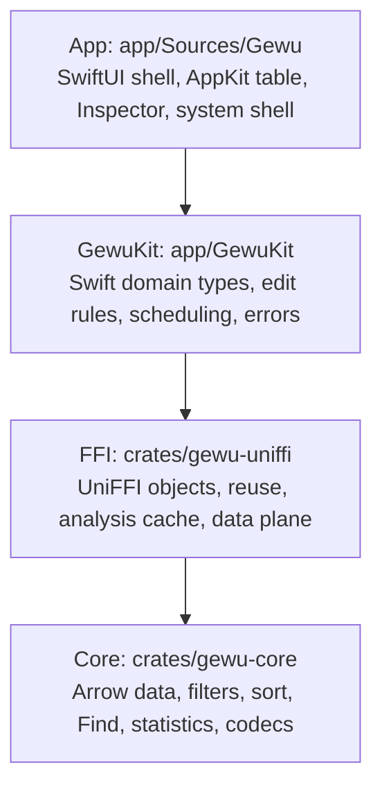
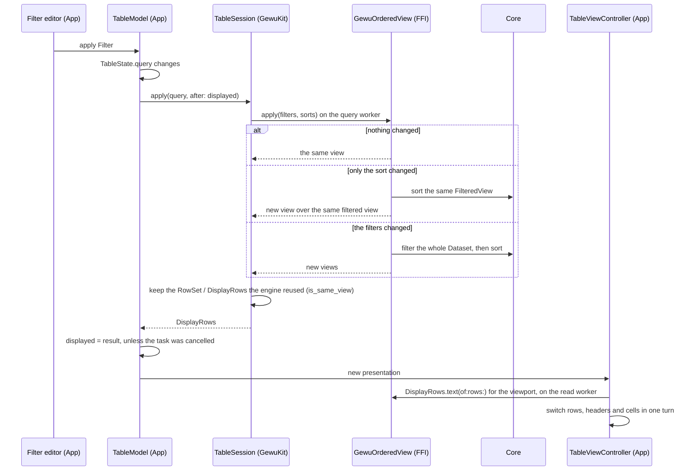

# Architecture

How Gewu is built today. This page describes the system. The [development guide](guide.md) holds the rules for changing it, and the [design notes](design/README.md) record why the key choices were made.

## Overview

Gewu is a read-only viewer for large tables. Opening a file decodes the selected table into memory once. After that, a filter produces source row numbers, a sort produces an order over them, and the table formats only the cells it shows.

Dependencies point one way, and each layer sees only the one below it.

## Technology

Gewu exists first of all to read Parquet, so it uses Apache Arrow's own Rust implementation: arrow-rs and its `parquet` crate. Other formats load into the same Arrow arrays. Rust does all data computation, including formatting display text, so there is one set of value semantics and one formatter. Swift presents: a SwiftUI shell around an AppKit `NSTableView` ([note](design/table-control.md)). UniFFI generates the bindings between them ([note](design/data-plane.md)).

## Scope

Gewu views, filters, sorts, inspects and exports one table at a time. These are out of scope:

- **Files larger than memory.** The whole selected table is decoded on open, so reads never wait for I/O.
- **Editing and undo.** A viewer changes no data.
- **A command-line interface.** The app is Core's only consumer.
- **NSDocument.** Saving, versions and autosave have no use in a viewer.
- **Localization, for now.** Errors stay structured so it remains possible ([note](design/structured-errors.md)).

## Result objects

Three immutable objects describe what is on screen, one per granularity of invalidation ([note](design/three-result-objects.md)):

| Object | Answers | Replaced when | Core / FFI / GewuKit |
| --- | --- | --- | --- |
| Dataset | What does the file contain? | the file or its open options change | `Dataset` / `GewuDataset` / `TableSource` |
| FilteredView | Which rows pass the filters? | the filters change | `FilteredView` / `GewuFilteredView` / `RowSet` |
| OrderedView | In what order are they shown? | the filters or the sort change | `OrderedView` / `GewuOrderedView` / `DisplayRows` |

- **A Dataset** holds the decoded columns, schema, file metadata and lazily built per-column dictionaries.
- **A FilteredView** holds its source rows and every analysis computed on them, including filter-editor choices.
- **An OrderedView** holds a display order and serves text, Find and export.

Visible columns belong to none of them. Find and export capture one OrderedView and stay valid whatever later queries do. GewuKit's result types compare by identity. The caller decides which result is current, so two windows can share a session and keep independent queries.

## Queries and edit state

What the user is editing lives in GewuKit's `TableState`, a value type. It holds:

- a `TableQuery`: the filters, at most one per column and kept in column order, and the sort keys by priority;
- the visible columns, and the selected, inspected and charted columns.

`TableState` keeps these consistent; for example, hiding a column removes its conditions. While a filter editor is open, its draft is a `FilterDraft`. Only the `TableQuery` reaches the engine. Two queries are equal exactly when they select the same rows in the same order, because filter values compare by their UTF-8 bytes, as Core compares them. Swift's `String` equality would merge spellings that Core keeps apart.

## Query flow

A newer query cancels the task, and so does returning to the displayed query. A failed query leaves `displayed` unchanged and returns the draft to it. Core compiles each filter once, evaluates it into a selection bitmap over all source rows, intersects the bitmaps, and sorts with per-key columnar kernels. Filter values cross the boundary as exact text, and Core parses them against the column's type. Inspector panels reload keyed by the `RowSet`, column and parameters, and find their results in the FFI's cache when nothing changed.

## Data plane

UniFFI carries the control plane: objects, records and errors. Large data takes one of two routes ([note](design/data-plane.md)):

- **Computed text moves by value.** A block of one column's display text returns as one `ColumnText` buffer, whose layout the [FFI README](../../crates/gewu-uniffi/README.md#bulk-data) specifies. Swift decodes a cell only when it shows it.
- **Resident data is lent in place.** Two hand-written C functions in [gewu_data.h](../../crates/gewu-uniffi/include/gewu_data.h) lend an ordered view's source rows and an in-memory export's bytes. Each returns a typed pointer into memory that a UniFFI object owns and never mutates, valid while Swift keeps that object alive.

Copy is a TSV export into memory with a byte cap, read in place, so copy and export share one serializer.

## Concurrency

Rust calls are synchronous and run to completion ([note](design/no-in-memory-cancellation.md)). GewuKit gives each session four serial workers, for query, analysis, read and Find, on dispatch queues off Swift's cooperative pool. Export, copy and worksheet listing each get a worker of their own. A call cancelled before it starts never enters Rust. A call already running finishes, and the App discards its result. Export alone can stop midway, and it replaces its destination only on completion.

## Errors

Core keeps concrete, module-owned errors. The FFI projects each failure a correct UI can meet into `GewuError`, with a structured kind and the values involved; contract violations become `Internal`. GewuKit carries the kind and an English diagnostic as `GewuKitError`, and turns cancellation from either side into `CancellationError`. The App's `ErrorPresentation` words every failure ([note](design/structured-errors.md)).

## Layer responsibilities

See [where semantics live](design/layer-semantics.md) for why the lines fall here.

- **Core** answers questions about data, whoever displays it: decoding and export, typed filters and Find, sorting, statistics, and filter-editor facets (the rows passing every other filter). It has no binding dependency. Its types reach Swift through `#[uniffi::remote]` declarations in the FFI crate.
- **The FFI** projects Core to Swift, and keeps the application rules that need engine identity:
  - `apply` reuses what did not change, and reports it through `is_same_view`;
  - each filtered view caches one result per analysis and column, never caches failures, and stays bounded by the schema;
  - Find steps and wraps;
  - scatter temporal coordinates become seconds.

  It defines its own types only where the boundary needs another shape.
- **GewuKit** wraps the generated bindings, which it imports with `internal import`. CI rejects imports of the bindings from the App and test targets. GewuKit exposes:
  - the result types, `TableSession`, and the Find and export jobs;
  - the edit state;
  - typed errors.

  It decides where each Rust call runs.
- **The App** presents, and owns presentation policy: viewport blocks, the table text cache and column widths. It reaches Rust only through GewuKit.

## Reading the code

Follow one query from the bottom up:

1. Core's [Dataset](../../crates/gewu-core/src/dataset/mod.rs) and [views](../../crates/gewu-core/src/view/mod.rs).
2. The FFI's [ordered_view.rs](../../crates/gewu-uniffi/src/ordered_view.rs) (`apply`), [cache.rs](../../crates/gewu-uniffi/src/cache.rs) and [data.rs](../../crates/gewu-uniffi/src/data.rs).
3. GewuKit's [TableSession.swift](../../app/GewuKit/Sources/Table/TableSession.swift) and [TableState.swift](../../app/GewuKit/Sources/Model/TableState.swift).
4. The App's [TableModel.swift](../../app/Sources/Gewu/Table/TableModel.swift) (`applyDraft`) and [TableViewController.swift](../../app/Sources/Gewu/Table/TableViewController.swift).

Each layer's tests state its contract by name.
