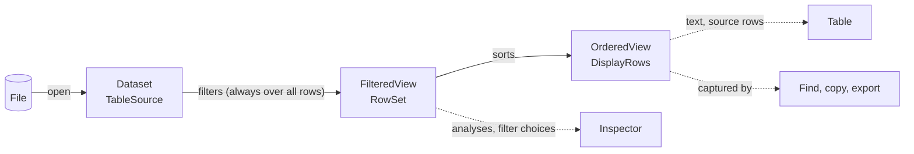
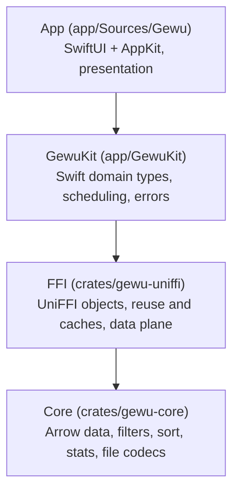

# Architecture

How Gewu is built: which objects stand between a file and a table cell, what each layer owns and must not contain, and why. Read this before changing code; the [development guide](guide.md) turns it into rules and recipes. Layer-specific API contracts are in the [Core](../../crates/gewu-core/README.md), [FFI](../../crates/gewu-uniffi/README.md) and [App and GewuKit](../../app/README.md) READMEs. The history behind the larger choices is in the [design documents](design/README.md).

## Mental model

Gewu is a read-only viewer for large tables. Opening a file decodes the selected table into memory once. After that nothing moves or copies the data: a filter produces a set of source row numbers, a sort produces an order over them, and the table formats only the cells it is about to show.

The interface is a native macOS app: a SwiftUI shell with AppKit's `NSTableView` for the grid, which virtualizes very large tables. All data computation is in a Rust library on arrow-rs, joined to Swift by UniFFI. Keeping computation in Rust means one set of value semantics and one formatter.

Three immutable objects describe what is on screen. Each answers one question and is replaced only when its own inputs change:

| Object | Answers | Replaced when | Keeps |
| --- | --- | --- | --- |
| Dataset | What does the file contain? | the file, worksheet or header option changes | decoded columns, schema, file metadata, per-column caches |
| FilteredView | Which rows pass the filters? | the filters change | the selected source rows; every analysis and filter-editor result |
| OrderedView | In what order are they shown? | the filters or the sort change | the display order; text, Find, copy and export read from it |

The same three objects appear in every layer:

| Layer | Dataset | FilteredView | OrderedView |
| --- | --- | --- | --- |
| Core (`gewu-core`) | `Dataset` | `FilteredView` | `OrderedView` |
| FFI (`gewu-uniffi`) | `GewuDataset` | `GewuFilteredView` | `GewuOrderedView` |
| GewuKit | `TableSource` | `RowSet` | `DisplayRows` |

Three layers exist because there are three granularities of invalidation. A sort does not change which rows pass, so it keeps the `RowSet` and all of its analyses; a single view type would discard them on every sort or need its own cache keys. Visible columns belong to no layer: showing, hiding or reordering a column without conditions costs no row computation. Find (`CellFind`) and export (`ExportJob`) capture one `DisplayRows` and stay valid whatever later queries do. GewuKit result types compare by object identity, never by contents.

Results are immutable and the caller decides which one is current. Filters always run against the whole dataset, so relaxing a filter brings rows back. An earlier design kept a mutable document in Rust with a version number that every read had to check; it made Rust own a window's state and every reader handle stale versions, and was replaced by this model.

## Layers

Dependencies point one way: App → GewuKit → FFI → Core. Each layer sees only the one below it. To decide where new logic goes, ask whether it is true of the data (Core), a rule about reusing or caching engine results (FFI), or a rule about what the user is editing (Swift).

### Core: general data semantics

Owns decoded Arrow data and everything that is true of data regardless of who displays it: typed filters and Find, sorting, statistics, file decoding and export. A filter editor's choices are computed here too ("values the other filters allow" is a data question). Core has no notion of a current view.

Must not contain:

- Frontend concepts: windows, visible columns, selection, panels, wording, or which result is current.
- A dependency on UniFFI or any binding generator. Core types whose shape suits the boundary are declared in the FFI crate with `#[uniffi::remote]`, so no conversion code exists. UniFFI derives in Core would make the engine depend on a binding generator; hand-written mirror types would be conversion code that drifts.
- Cancellation checks in in-memory scans (see [Concurrency and cancellation](#concurrency-and-cancellation)).

### FFI: the boundary, plus app semantics that read better in Rust

Projects Core to Swift and carries the application rules that are clearest next to the data: `apply(filters, sorts)` reuses whatever did not change, each filtered view caches its analyses, Find steps and wraps internally, scatter temporal coordinates are converted to seconds. Swift follows the engine's reuse (`is_same_view`) instead of deciding it again. A first version kept the FFI stateless with these rules in Swift; reuse was then decided on both sides and Swift needed its own caches.

The FFI defines its own types only where the boundary needs another shape (UniFFI has no tuples, seconds for coordinates, the open options the app sets, errors, bulk data). Objects carry the `Gewu` prefix; records do not.

Must not contain:

- Query algorithms or codecs.
- Interaction state: drafts, edit rules, selection.
- Scheduling. Every export is synchronous; Swift decides where and when it runs.

### GewuKit: the Swift domain layer

The only Swift module that imports the generated bindings (`GewuBindings`, `gewuFFI`), with `internal import`; CI rejects imports anywhere else. It exposes the three result types, `TableSession`, `CellFind` and `ExportJob`, Swift values for queries and results, `GewuKitError`, and the value types that hold the rules of what the user edits (`TableState`, `FilterDraft`). It runs every Rust call on a serial worker. Before it existed, App views named FFI types directly and every boundary change rippled into the UI.

Must not contain:

- Public binding types.
- User-facing wording.
- Presentation policy: viewport blocks, table caches, layout.

### App: presentation

SwiftUI and AppKit: windows, the native table, filter editors, Inspector and charts, settings, and the system shell (save panels, pasteboard, updates). Models are `@Observable`, each piece of state has one owner whose lifetime matches it, and models never refer to views. Swift 6 language mode checks data races.

Must not contain:

- Imports of `GewuBindings` or `gewuFFI`, or FFI type names.
- Data computation, or reuse decisions that belong to the engine.
- `@unchecked Sendable`.

## Where state lives

| State | Owner | Why there |
| --- | --- | --- |
| Decoded data, per-column dictionaries | Core `Dataset` | Shared by every view and window over the file. |
| Rows of a query, display order | Core views, held by FFI objects | Immutable; shared without copying. |
| Analysis results for a row set | FFI `GewuFilteredView` | Order-independent, so every ordering shares them; released with the view. |
| Which filters and sorts a view answers | FFI views | Lets `apply` decide reuse in one place. |
| The applied result (`displayed`), the draft query, visible, selected, inspected and charted columns | App `TableModel`, with rules in GewuKit `TableState` | Interaction state: one window's choice. |
| An open filter editor's draft | GewuKit `FilterDraft`, held by the App | Interaction state. |
| Table text blocks, viewport, column widths | App table controller and `TableTextCache` | Presentation policy. |
| Window, worksheet list, Inspector page and settings, alerts | App `WindowModel` | Lifetime of the window. |

Two windows can share a `TableSession` and keep independent queries.

## The query path

What happens when the user applies a filter:

1. A filter editor edits a `FilterDraft`. Apply sends the `Filter` to `TableModel`, which updates its `TableState`. The draft query changes at once; `displayed` does not.
2. `TableModel` starts one task: `TableSession.apply(draft, after: displayed)` on the query worker. A newer draft cancels it, and so does returning to the displayed query.
3. GewuKit calls `GewuOrderedView.apply(filters, sorts)`. The FFI returns the same view when nothing changed, a new order over the same filtered view when only the sort changed, and otherwise filters the **whole dataset** and sorts the result. GewuKit asks `is_same_view` and keeps the matching `RowSet` and `DisplayRows`.
4. Core compiles each filter once, evaluates it into a selection bitmap over all source rows, intersects the bitmaps into source row IDs, then sorts with per-key columnar kernels.
5. If the task was not cancelled, `TableModel` sets `displayed`. On failure, `displayed` stays and the draft returns to it.
6. The table controller keeps showing the old rows while `TableTextCache` reads the new viewport (`DisplayRows.text` → `format_column`), then switches rows, headers and cells in one main-actor turn. Inspector panels reload in `.task(id:)` keyed by the `RowSet`, column and parameters, and hit the FFI cache when nothing changed.

Filter values cross the boundary as exact text, never as display labels, plot coordinates or dictionary codes. Core parses the text once against the column's type and uses dictionary codes internally where it has them. An early design sent dictionary keys back from checkbox lists; keys exist only for encoded columns and tie the protocol to one encoding. Exact values compare by UTF-8 bytes on both sides, because Swift's `String` equality merges canonically equivalent spellings that Core keeps apart.

## The data plane

UniFFI serializes values and passes objects as opaque handles. Its Swift side copies a returned byte vector into an array and then into `Data`, and zero-copy byte slices work only as arguments, not return values. Large data therefore takes one of two routes:

- **Computed results move by value in one buffer.** A block of one column's display text is formatted in Rust and returned as one `ColumnText` record: `u32` offsets, a validity bitmap, then UTF-8. Swift decodes a cell only when it binds it, and the table caches and evicts per column.
- **Resident data is lent in place.** Two hand-written C functions in [gewu_data.h](../../crates/gewu-uniffi/include/gewu_data.h) take a handle cloned from a UniFFI object, consume it, and return a typed pointer and length into memory that object owns: the source rows of an ordered view, and the bytes of an in-memory export. The pointer is valid, and the memory unchanged, while Swift keeps that object alive. GewuKit is the only caller: `RowNumbers` stores the owning view next to the pointer, and copying reads exported bytes inside `withExtendedLifetime`.

Why a hand-written C ABI rather than an address and length passed through UniFFI: a pointer passed as integers (a `BufferView { address, length }` record, or a handle object with `address()` and `len()`, both tried during #17) is still a pointer, only untyped and outside any declared contract. The C declarations give Swift a real `UnsafePointer<UInt32>` or `UnsafePointer<UInt8>`, put the safety contract next to the type in one header, and keep the lending code in one Rust file with `SAFETY` comments. Returning `Vec` through UniFFI was rejected because it copies on every read; the Arrow C Data Interface because it would move formatting and type handling into Swift; `Data(bytesNoCopy:)` because it interleaves Foundation's deallocation with UniFFI's handle release.

## Concurrency and cancellation

Rust calls are synchronous and run to completion. In-memory filters, sorts, analyses and Find have no cancellation checks: on in-memory data they are bounded CPU work, and the checkpoints they once had added a branch and an error path to every kernel. Instead, GewuKit gives each session serial workers (query, analysis, read, find) on dedicated dispatch queues, off Swift's cooperative pool, so a long scan never blocks scrolling or another kind of work. Exports, copies and worksheet listing run on a worker created for that call.

A call whose task is cancelled before it reaches its worker never enters Rust. A call already running finishes and its caller discards the result: every App handler checks for cancellation before touching state, so a cancelled task changes nothing, even when it failed. UniFFI async exports were not used: they need an executor in Rust, and dropping the future would not stop a running scan anyway.

Export is the one operation Rust can stop midway, because it writes files and can run long. It writes to a temporary file and replaces the destination only when it completes.

## Errors

Core keeps concrete, module-owned errors. The FFI projects them to `GewuError` with structured kinds, carrying the values involved, for every failure a correct UI can meet in normal use; contract violations become `Internal`. GewuKit translates them into `GewuKitError { kind, diagnostic }` and turns both Swift and Rust cancellation into `CancellationError`. The App's `ErrorPresentation` is the only place that words failures. Folding errors into strings earlier would lose what happened and fix the language of every message in Rust; kinds keep localization possible.

## Copy is an export

Copy is a TSV export of the selected display rows and visible columns written into memory, with nested values as display text and a byte cap. Swift reads the result in place and copies it once to the pasteboard. There is no second serializer: what copy produces is exactly what TSV export would write.

## Intentionally not done

- **Undo.** Undo protects edits, and a read-only viewer never changes data; clearing filters and the sort editor are the ways back. `TableQuery` is a value type so equality can decide whether a query must run, not to support undo.
- **Cancelling in-memory operations.** See [Concurrency and cancellation](#concurrency-and-cancellation).
- **A CLI or MCP server.** The app is Core's only consumer, and Core's API is shaped for an interactive caller holding views. A CLI shipped in the first commit and was removed as a mismatch; an MCP server was planned and never built. Scripted analysis is left to Python and the exported formats.
- **gpui.** A Rust UI framework would have kept one language, but was judged too unstable to build on.
- **Polars as the engine.** Core works directly on arrow-rs arrays. DataFusion remains the candidate if larger-than-memory files are ever needed.
- **Larger-than-memory files.** Lazy loading would make every query and scroll depend on I/O. Deferred, not ruled out; the interface would have to change with it.
- **NSDocument.** Its saving, versions and autosave have no use in a viewer; `WindowGroup(for: URL)` already gives restoration and recent files.
- **Localization, for now.** Not done, but errors are structured and wording is confined to `ErrorPresentation` so it stays possible.

## Reading the code

Follow one query from the bottom up:

1. **Core results.** [dataset/mod.rs](../../crates/gewu-core/src/dataset/mod.rs) (`Dataset`), [dataset/filter.rs](../../crates/gewu-core/src/dataset/filter.rs) (`Dataset::filter`), then [view/mod.rs](../../crates/gewu-core/src/view/mod.rs) for `FilteredView` and `OrderedView`. [row_ids.rs](../../crates/gewu-core/src/row_ids.rs) shows how rows are represented without copying data.
2. **Core operations, as needed.** [execution/](../../crates/gewu-core/src/execution) for selections and sorting, [column/predicate/](../../crates/gewu-core/src/column/predicate) for filters and Find, [stats/](../../crates/gewu-core/src/stats) for analyses, [file/](../../crates/gewu-core/src/file) for codecs. The [Core code map](../../crates/gewu-core/README.md#code-map) lists the rest.
3. **The boundary.** [ordered_view.rs](../../crates/gewu-uniffi/src/ordered_view.rs) (`apply`), [filtered_view.rs](../../crates/gewu-uniffi/src/filtered_view.rs) with [cache.rs](../../crates/gewu-uniffi/src/cache.rs), [data.rs](../../crates/gewu-uniffi/src/data.rs) with [gewu_data.h](../../crates/gewu-uniffi/include/gewu_data.h), [error.rs](../../crates/gewu-uniffi/src/error.rs).
4. **GewuKit.** [TableSession.swift](../../app/GewuKit/Sources/Table/TableSession.swift), [RowSet.swift](../../app/GewuKit/Sources/Table/RowSet.swift), [DisplayRows.swift](../../app/GewuKit/Sources/Table/DisplayRows.swift), [SerialWorker.swift](../../app/GewuKit/Sources/Execution/SerialWorker.swift), [TableState.swift](../../app/GewuKit/Sources/Model/TableState.swift), [GewuKitError.swift](../../app/GewuKit/Sources/GewuKitError.swift).
5. **The App.** [GewuApp.swift](../../app/Sources/Gewu/App/GewuApp.swift), [WindowModel.swift](../../app/Sources/Gewu/Window/WindowModel.swift), [TableModel.swift](../../app/Sources/Gewu/Table/TableModel.swift) (`applyDraft` is the query path), then [TableViewController.swift](../../app/Sources/Gewu/Table/TableViewController.swift) with [TableTextCache.swift](../../app/Sources/Gewu/Table/TableTextCache.swift).

Tests state each layer's contract by name: [Core](../../crates/gewu-core/tests), [FFI](../../crates/gewu-uniffi/src/tests.rs), [GewuKit](../../app/GewuKit/Tests), [App](../../app/Tests).

## Where to change what

| To change | Start in |
| --- | --- |
| How a type parses, compares or displays values | Core `column/`, `scalar/`, `format.rs`; behavior in [data types](../spec/data-types.md) |
| Filter or Find semantics | Core `query/`, `column/predicate/`, `find.rs`; behavior in [Find and filtering](../spec/search-and-filter.md) |
| Sorting | Core `execution/sort.rs` |
| Statistics, histograms, scatter | Core `stats/`, exposed by `view/analysis.rs` |
| Reading or writing a format | Core `file/`; behavior in [file formats](../spec/file-formats.md) |
| What crosses to Swift, reuse, analysis caching | `crates/gewu-uniffi/src` |
| Swift types, scheduling, error kinds | `app/GewuKit/Sources` |
| Edit rules (sort cycling, hiding clears conditions, filter drafts) | GewuKit `Model/TableState.swift`, `Model/FilterDraft.swift` |
| Window, table, Inspector, filter editors | `app/Sources/Gewu/<area>`; see the [App code map](../../app/README.md#code-map); behavior in [interface](../spec/interface.md) |
| Error wording | `app/Sources/Gewu/App/ErrorPresentation.swift` |
| Building the bindings | [scripts/build-rust.sh](../../scripts/build-rust.sh), [project.yml](../../project.yml) |
