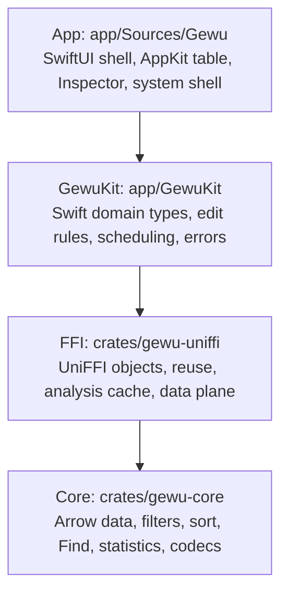
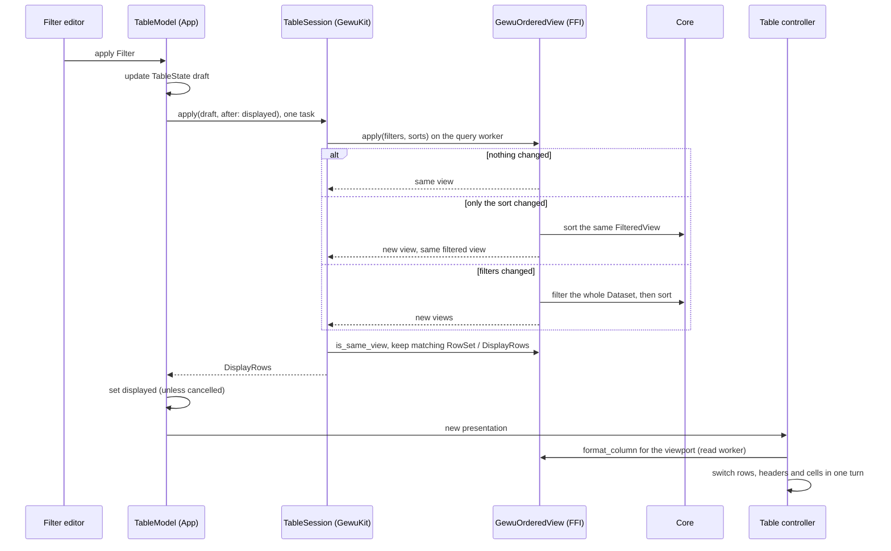

# Architecture

How Gewu is built today. This page describes; the [development guide](guide.md) says how to change it, and the [design notes](design/README.md) record why the key choices were made.

## Overview

Gewu is a read-only viewer for large tables: a native macOS app over a Rust engine. Opening a file decodes it into memory once. After that a filter produces source row numbers, a sort produces an order over them, and the table formats only the cells it shows. All data computation is in Rust, so there is one set of value semantics and one formatter. See the [technology stack](design/tech-stack.md) note for why Swift, AppKit, arrow-rs and UniFFI.

Dependencies point one way, and each layer sees only the one below it.

## Scope and non-goals

Gewu views, filters, sorts, inspects and exports one table at a time. Deeper analysis is left to Python and the exported formats. These are intentionally not done:

- **Editing and undo.** A viewer changes no data; clearing filters is the way back.
- **Larger-than-memory files.** Deferred, not ruled out ([note](design/in-memory-without-cancellation.md)).
- **Cancelling in-memory scans.** They run to completion ([note](design/in-memory-without-cancellation.md)).
- **A CLI.** Core is a resident engine holding views, a poor fit for one-shot commands; an early CLI was removed. MCP, RPC or a daemon are possible future directions, not plans.
- **gpui.** See the [technology stack](design/tech-stack.md).
- **NSDocument.** Saving, versions and autosave have no use in a viewer.
- **Localization, for now.** Kept possible by [structured errors](design/structured-errors.md).

## Result objects

Three immutable objects describe what is on screen, one per granularity of invalidation ([note](design/three-result-objects.md)):

| Object | Answers | Replaced when | Core / FFI / GewuKit |
| --- | --- | --- | --- |
| Dataset | What does the file contain? | the file or its open options change | `Dataset` / `GewuDataset` / `TableSource` |
| FilteredView | Which rows pass the filters? | the filters change | `FilteredView` / `GewuFilteredView` / `RowSet` |
| OrderedView | In what order are they shown? | the filters or the sort change | `OrderedView` / `GewuOrderedView` / `DisplayRows` |

A Dataset holds the decoded columns, schema, file metadata and lazily built per-column dictionaries. A FilteredView holds its source rows and every analysis computed on them, including filter-editor choices. An OrderedView holds a display order and serves text, Find and export. Visible columns belong to none of them. GewuKit's result types compare by identity. Find and export capture one `DisplayRows` and stay valid whatever later queries do. The caller decides which result is current; two windows can share a session and keep independent queries.

## Query flow

A newer draft cancels the task, and so does returning to the displayed query. A failed query leaves `displayed` unchanged and returns the draft to it. Core compiles each filter once, evaluates it into a selection bitmap over all source rows, intersects the bitmaps, and sorts with per-key columnar kernels. Inspector panels reload keyed by the `RowSet`, column and parameters, and hit the FFI's cache when nothing changed.

Filter values cross the boundary as exact text, never as display labels, plot coordinates or dictionary codes. Core parses them against the column's type. Exact values compare by UTF-8 bytes on both sides, because Swift's `String` equality merges spellings Core keeps apart.

## Data plane

UniFFI carries the control plane: objects, records and errors. Large data takes one of two routes ([note](design/data-plane.md)):

- **Computed text moves by value.** A block of one column's display text returns as one `ColumnText` buffer: `u32` offsets, a validity bitmap, then UTF-8. Swift decodes a cell only when it shows it.
- **Resident data is lent in place.** Two hand-written C functions in [gewu_data.h](../../crates/gewu-uniffi/include/gewu_data.h) lend an ordered view's source rows and an in-memory export's bytes. Each consumes a cloned UniFFI handle and returns a typed pointer into memory that object owns and never mutates. The pointer is valid while Swift keeps the object alive.

Copy is a TSV export into memory with a byte cap, read in place, so copy and export share one serializer.

## Concurrency

Rust calls are synchronous and run to completion. GewuKit gives each session four serial workers (query, analysis, read and find) on dispatch queues off Swift's cooperative pool. Export, copy and worksheet listing each get a worker of their own. A call cancelled before it starts never enters Rust. A call already running finishes, and the App discards its result: every task handler checks for cancellation before touching state. Export alone stops midway in Rust, and replaces its destination only on completion ([note](design/in-memory-without-cancellation.md)).

## Errors

Core keeps concrete, module-owned errors. The FFI projects each failure a correct UI can meet into `GewuError`, with a structured kind and the values involved; contract violations become `Internal`. GewuKit carries the kind and an English diagnostic as `GewuKitError`, and turns cancellation from either side into `CancellationError`. The App's `ErrorPresentation` is the only place that words failures ([note](design/structured-errors.md)).

## Layer responsibilities

See [where semantics live](design/layer-semantics.md) for why the lines fall here.

- **Core** answers questions about data, whoever displays it: decoding and export, typed filters and Find, sorting, statistics, and filter-editor facets (the rows passing every other filter). It knows nothing of windows, visible columns, selection, wording or display units, and depends on no binding generator. Its types reach Swift through `#[uniffi::remote]` declarations in the FFI crate.
- **The FFI** projects Core to Swift and keeps the application rules clearest next to the data:
  - `apply` reuses what did not change, and Swift follows `is_same_view`;
  - each filtered view caches one result per analysis and column, never caches failures, and stays bounded by the schema;
  - Find steps and wraps internally;
  - scatter temporal coordinates become seconds.

  It defines its own types only where the boundary needs another shape. It holds no interaction state and schedules nothing.
- **GewuKit** is the only module that imports the generated bindings, with `internal import`; CI checks this. It exposes the result types, `TableSession`, Find and export jobs, and typed errors. It keeps the rules of what the user edits in value types: `TableState` (query, visible and chosen columns) and `FilterDraft`. It decides where each Rust call runs, but contains no wording and no presentation policy.
- **The App** presents. Models are `@Observable`, each piece of state has one owner whose lifetime matches it, and models never refer to views. It is compiled in Swift 6 language mode, with no `@unchecked Sendable`. It owns presentation policy: viewport blocks, the table text cache and column widths.

## Reading the code

Follow one query from the bottom up:

1. Core's [Dataset](../../crates/gewu-core/src/dataset/mod.rs) and [views](../../crates/gewu-core/src/view/mod.rs).
2. The FFI's [ordered_view.rs](../../crates/gewu-uniffi/src/ordered_view.rs) (`apply`), [cache.rs](../../crates/gewu-uniffi/src/cache.rs) and [data.rs](../../crates/gewu-uniffi/src/data.rs).
3. GewuKit's [TableSession.swift](../../app/GewuKit/Sources/Table/TableSession.swift) and [TableState.swift](../../app/GewuKit/Sources/Model/TableState.swift).
4. The App's [TableModel.swift](../../app/Sources/Gewu/Table/TableModel.swift) (`applyDraft`) and [TableViewController.swift](../../app/Sources/Gewu/Table/TableViewController.swift).

Each layer's tests state its contract by name.
